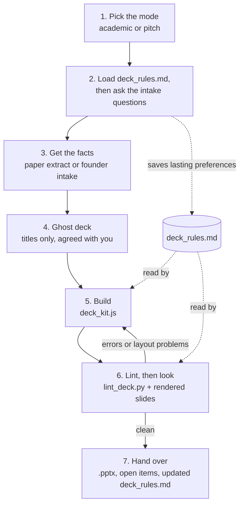

# Academic + Pitch Deck Skill for Claude

A Claude Skill for decks that have to survive scrutiny: **academic talks** (conference
papers, seminars, thesis defenses, job talks) and **startup pitch decks** (pre-seed to
Series A, in the form YC, Sequoia and a16z ask for).

This is a fork of [gabberflast/academic-pptx-skill](https://github.com/gabberflast/academic-pptx-skill).
The original taught Claude the rules of a good academic deck. This fork keeps those
rules, adds a pitch mode, and adds scripts that build to the rules and check the result.

## How it works

Ask Claude for a deck and the skill takes it through seven steps. Two of them stop for
you: the intake questions, and the outline.



1. **Pick the mode.** Academic when the audience is evaluating research; pitch when it
   is investors. The audience decides, not the presenter.
2. **Load your rules, then intake.** Claude looks for `deck_rules.md` in the attachments
   or your project folder and applies it without being asked. Then it asks, in one
   round of at most four questions, whatever is still open: what to build from (a
   paper, an old deck, data, notes, company material, or an interview), the colour
   scheme, the slot (minutes and audience, or funding stage and format), and any house
   rules. Lasting preferences are saved to `deck_rules.md`.
3. **Get the facts.** For a paper, `extract_paper.py` pulls out sections, captions,
   references and the sentences that carry numbers. For a pitch, Claude collects the
   founder's facts: problem, traction, market, model, team, ask. Anything missing
   becomes a `NEEDS` placeholder. Nothing is invented.
4. **Ghost deck.** Every slide title is written as a full-sentence claim, in order,
   before any slide exists. If the titles do not make the argument on their own, the
   outline is fixed first. You approve it, unless the deck is short and the content is
   clear.
5. **Build.** `deck_kit.js` lays out each slide, applies your colours, numbers the
   slides and attaches speaker notes. It warns when a title or body is too long and
   never shrinks type to make content fit.
6. **Lint, then look.** `lint_deck.py` opens the finished `.pptx` and reports problems
   with a fix for each, applies your custom limits, banned words and required slides,
   and prints your written house rules as a checklist. Errors are fixed before going
   on. Then Claude renders the slides to images and checks each one for overlap,
   clipped text and gaps. Any problem sends it back to step 5.
7. **Hand over.** You get the `.pptx`, a short note on the claim the deck makes and
   anything left open, and the updated `deck_rules.md` if it changed.

The same steps are spelled out for Claude in [SKILL.md](SKILL.md).

## What the fork adds

| | Original | This fork |
|---|----------|-----------|
| Modes | Academic | Academic **and pitch** (YC seed order, Sequoia outline, stage-by-stage guidance, founder intake list) |
| Building slides | Copy-paste PptxGenJS snippets with fixed coordinates | `scripts/deck_kit.js`: slide builders that measure the title, flow the layout from it, number slides and warn on overfull slides |
| Checking | A checklist for the model to read | `scripts/lint_deck.py`: opens the finished `.pptx` and reports violations with a fix for each; non-zero exit on errors |
| Starting from a paper | — | `scripts/extract_paper.py` (PDF or LaTeX → sections, captions, references, numbers, figures) and a ten-step paper-to-talk workflow |
| Made-up content | "Cite everything borrowed" | Explicit rules against invented numbers, citations and customers; a `NEEDS()` placeholder the linter refuses to pass; `--source` traces every number on a slide back to the paper |
| Speaker notes, slide numbers | — | Required by the kit, checked by the linter |
| Your own rules | — | `deck_rules.md`: a file you keep that records your colours, typeface, limits, banned words, required slides and house rules. The kit and linter read it; Claude adds to it when you state a lasting preference |
| Intake | — | Claude asks up front what to build from (paper, old deck, data, notes) and which colour scheme to use: ten named schemes, your own hex colours, or "match this deck" |
| Tests | — | `tests/run_tests.py`: end-to-end checks of the kit, linter, extractor and rules file |

It also fixes problems in the original: guidance that contradicted its own code (rules
under titles, title alignment, where the References slide goes), example snippets below
the stated font minimums, a default grey that fails WCAG contrast, a bullet pattern
that renders differently in PowerPoint and LibreOffice, and example references with
wrong details. [CHANGELOG.md](CHANGELOG.md) has the list.

## What the linter catches

```
$ python3 scripts/lint_deck.py talk.pptx --mode academic --minutes 12
talk.pptx — academic mode — 4 slides (4 presented, 0 references, 0 appendix)

GHOST DECK — read the titles in order. Do they make the whole argument on their own?
   1  [title] A study of tutoring
   2          Results
   3          Tutoring effects fade quickly in most earlier studies
   4  [!!]    Thank you!

FINDINGS — 7 error(s), 2 warning(s), 2 note(s)
  ERROR   deck      A-CONCLUSIONS: no conclusions slide
  ERROR   deck      A-REFERENCES: 1 in-slide citation(s) but no References slide
  ERROR   slide 2   FONT-SMALL: body text at 11 pt (minimum 20)
  ERROR   slide 2   TITLE-LABEL: title is a topic label: “Results”
                    fix: Rewrite as a sentence that states the takeaway, e.g. “Results” → “Treatment raises earnings 18%”.
  ERROR   slide 2   WORDS: 80 words of body text (limit 40)
  ERROR   slide 3   PLACEHOLDER: unfilled placeholder: “Effect size: [[NEEDS: pooled estimate]]”
  ERROR   slide 4   THANKS-SLIDE: “Thank you!” slide
  WARNING deck      A-QUESTION: no research question or central claim found in slides 2–4
  WARNING deck      SLIDE-NUMBERS: slides are not numbered
  ...
RESULT: FAIL — fix the errors and run again
```

(Output shortened: every finding comes with a `fix:` line.)

| Shared | Academic | Pitch |
|--------|----------|-------|
| Topic-label titles, titles with no verb | No research question in slides 2–4 | Missing sections (problem, solution, market, model, team, ask) |
| Body words over the limit | No conclusions slide, or content after it | Traction slide with no number |
| Type below the floor; chart labels under 16 pt | Citation with no full reference | Growth figure with no time window |
| Contrast under 4.5:1 | More slides than minutes | Market with no size, or no arithmetic |
| Text overflowing its box or the slide | Numbers not found in the source paper (`--source`) | "No competitors"; buzzwords |
| More than one exhibit; exhibit with no source line or call-out | "Thank you" slide | Valuation or cap on the ask slide |
| Unfilled placeholders; missing notes and slide numbers | | More than 15 slides before the appendix |

With a `deck_rules.md` it also flags your banned words, a missing required slide, a
typeface other than yours, and more slides than your limit.

It checks form, and prints the ghost deck so a reader can judge the argument. It works
on any `.pptx`, most precisely on decks built with the kit.

## Installation

1. Download this repository as a zip (**Code → Download ZIP**)
2. In [claude.ai](https://claude.ai), go to **Customize → Skills** and upload the zip
3. Confirm the skill is listed and switched on

Code execution and file creation must be enabled in **Settings → Capabilities**.

## Usage

Ask naturally:

- *"Make slides for my conference paper"* (attach the PDF)
- *"Turn this paper into a 15-minute talk"*
- *"Build a deck for my thesis defense"*
- *"Make a seed pitch deck for my startup"*
- *"Review my pitch deck"* (attach the `.pptx`)

The skill works alongside Anthropic's built-in PPTX skill, which handles the file
format. This skill handles content, structure and checking.

### Your own rules

Tell Claude a lasting preference ("always use our green", "never more than 12 slides",
"ban the word synergy") and it is written to `deck_rules.md`. Keep that file in your
project folder, or attach it next time, and every later deck starts from it. You can
also edit it by hand; it is plain markdown. See [customization.md](customization.md).

```bash
python3 scripts/deck_rules.py init
python3 scripts/deck_rules.py set scheme emerald --scope pitch
python3 scripts/deck_rules.py set banned_words "synergy, leverage"
python3 scripts/deck_rules.py add "The title slide carries the round and the month" --scope pitch
python3 scripts/deck_rules.py from-template brand.pptx     # read colours and fonts from an existing deck
```

A rules file can change style, structure and limits. It cannot switch off the checks
for unfilled placeholders, uncited sources or numbers missing from the paper.

The scripts also run on their own:

```bash
python3 scripts/extract_paper.py paper.pdf --out paper_out
NODE_PATH=$(npm root -g) node examples/build_academic_example.js talk.pptx
python3 scripts/lint_deck.py talk.pptx --mode academic --minutes 12 --source paper_out/paper.json
python3 scripts/lint_deck.py deck.pptx --mode pitch
python3 scripts/lint_deck.py any_deck.pptx --ghost        # just the titles, in order
```

Requirements: Node with `pptxgenjs`; Python with `python-pptx`; poppler
(`pdftotext`, `pdfimages`, `pdftoppm`) or `pypdf` for PDFs; LibreOffice to render
slides for a visual check.

## File structure

```
├── SKILL.md                         Entry point: mode choice, workflow, design standards
├── customization.md                 Intake questions, colour schemes, the deck_rules.md format
├── academic/
│   ├── content_guidelines.md        Argument structure, action titles, exhibits, citations, timing
│   ├── slide_patterns.md            Each academic slide type, built with the kit
│   └── paper_to_deck.md             Workflow from a paper (PDF or LaTeX) to a talk
├── pitch/
│   ├── pitch_guidelines.md          Sections, order, stage differences, intake, integrity rules
│   └── slide_patterns.md            Each pitch section, built with the kit
├── scripts/
│   ├── deck_kit.js                  Slide builders on PptxGenJS
│   ├── lint_deck.py                 Deck linter
│   ├── deck_rules.py                Reads and updates the user's deck_rules.md
│   └── extract_paper.py             Paper → talk material
├── examples/                        Two complete build scripts (content is invented)
├── tests/                           End-to-end tests and a small invented paper as fixture
└── Academic_Presentation_Best_Practices_…pdf    The original author's summary of the academic advice
```

## Tests

```bash
python3 tests/run_tests.py
```

Builds both example decks, lints them, builds deliberately bad decks and asserts which
rules fire, runs the paper extractor on the fixture, checks that a tampered number is
caught, and exercises the rules file (settings, scoping, locked checks, colour schemes).

## Background

The academic guidance comes from the original skill, which draws on Barbara Minto's
*Pyramid Principle*, Naegle (2021), "Ten simple rules for effective presentation
slides" (*PLOS Computational Biology*), and standard consulting and conference practice.

The pitch guidance summarises, in this skill's own words:

- Y Combinator, [How to build your seed round pitch deck](https://www.ycombinator.com/library/2u-how-to-build-your-seed-round-pitch-deck)
- Kevin Hale, [How to design a better pitch deck](https://www.ycombinator.com/blog/how-to-design-a-better-pitch-deck)
- Sequoia Capital, [Writing a business plan](https://sequoiacap.com/article/writing-a-business-plan)
- a16z speedrun, [Andrew Chen's "dinner party jerk" test](https://speedrun.substack.com/p/andrew-chen-dinner-party-jerk-test)

All example content in this repository (the tutoring study, the company "Ledgerline",
every number and reference) is invented for illustration.

## License

MIT, as in the original. Original work © 2026 Gabberflast; see [LICENSE](LICENSE).
